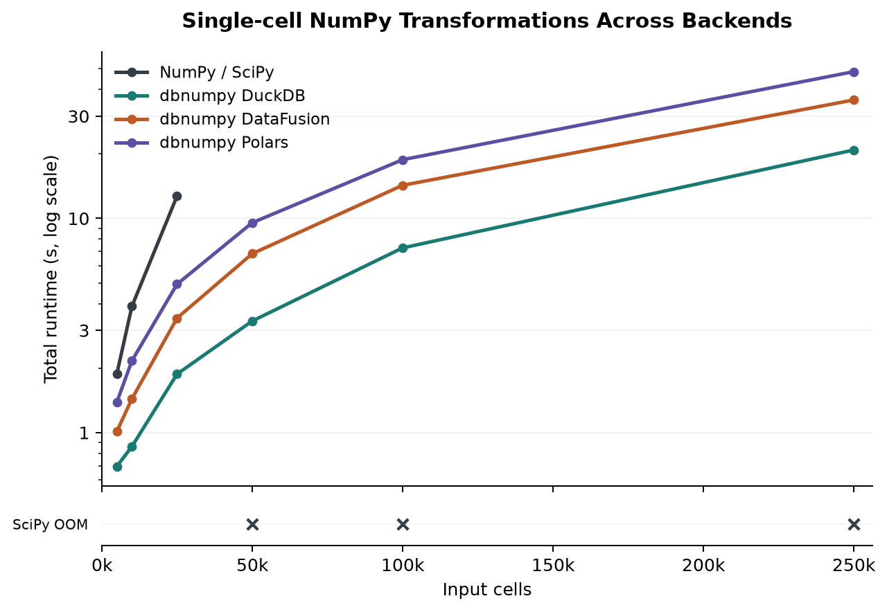

# Computing and storing the normalized matrix

The summary benchmark already computes the filtering, normalization and gene statistics. This follow-up adds `result.values.compute()` after the same workflow. It stores the complete normalized matrix inside the database, without exporting that matrix to Python.



## Results (October 29, 2026)

Measured with dbnumpy `dce82b4`, DuckDB 2.0.0, DataFusion 55.0.0, Polars 2.1.0,
NumPy 2.5.3 and SciPy 1.18.1 on Python 3.12, in WSL 2 on an Intel Core Ultra 5
125U. Every engine and BLAS library uses all 14 CPU threads.

| Input cells | Method | Median total (range) | Of which `compute()` | Peak memory |
|---:|---|---:|---:|---:|
| 5,000 | NumPy / SciPy | 1.9 s (1.9–1.9) | — | 0.98 GiB |
| 5,000 | DuckDB 2.0 | 0.7 s (0.6–0.7) | 0.1 s | 0.48 GiB |
| 5,000 | DataFusion 55 | 1.0 s (1.0–1.0) | 0.3 s | 0.59 GiB |
| 5,000 | Polars 2.1 | 1.4 s (1.4–1.4) | 0.3 s | 0.69 GiB |
| 10,000 | NumPy / SciPy | 3.9 s (3.9–4.8) | — | 1.88 GiB |
| 10,000 | DuckDB 2.0 | 0.9 s (0.9–0.9) | 0.2 s | 0.76 GiB |
| 10,000 | DataFusion 55 | 1.4 s (1.4–1.4) | 0.5 s | 0.74 GiB |
| 10,000 | Polars 2.1 | 2.2 s (2.2–2.2) | 0.5 s | 1.05 GiB |
| 25,000 | NumPy / SciPy | 12.7 s (11.0–14.6) | — | 4.58 GiB |
| 25,000 | DuckDB 2.0 | 1.9 s (1.8–2.1) | 0.6 s | 1.57 GiB |
| 25,000 | DataFusion 55 | 3.4 s (3.4–3.6) | 1.3 s | 1.04 GiB |
| 25,000 | Polars 2.1 | 4.9 s (4.8–5.0) | 1.3 s | 1.08 GiB |
| 50,000 | NumPy / SciPy | × | — | — |
| 50,000 | DuckDB 2.0 | 3.3 s (3.3–4.4) | 1.0 s | 2.93 GiB |
| 50,000 | DataFusion 55 | 6.8 s (6.7–6.9) | 2.7 s | 1.63 GiB |
| 50,000 | Polars 2.1 | 9.5 s (9.5–9.9) | 2.6 s | 1.99 GiB |
| 100,000 | NumPy / SciPy | × | — | — |
| 100,000 | DuckDB 2.0 | 7.3 s (6.9–8.3) | 2.8 s | 4.09 GiB |
| 100,000 | DataFusion 55 | 14.3 s (13.9–14.3) | 5.4 s | 2.33 GiB |
| 100,000 | Polars 2.1 | 18.8 s (18.8–18.9) | 5.2 s | 2.14 GiB |
| 250,000 | NumPy / SciPy | × | — | — |
| 250,000 | DuckDB 2.0 | 20.9 s (20.5–31.4) | 10.0 s | 4.25 GiB |
| 250,000 | DataFusion 55 | 35.7 s (35.3–35.8) | 14.1 s | 4.00 GiB |
| 250,000 | Polars 2.1 | 48.4 s (48.0–56.9) | 14.0 s | 2.27 GiB |

× means all three runs ran out of memory. All 63 completed runs passed the
correctness checks below.

DuckDB is fastest at every size. DataFusion takes 35.7 s at 250,000 cells;
before dbnumpy raised its broadcast-join limits, the same run took 84.2 s
because each join with a small selector or scale vector repartitioned the whole
coordinate relation. Polars uses the least memory from 100,000 cells.

How the runs were made:

- Three repeats per point; the table and figure show the median.
- Each run is a fresh process in a systemd scope capped at 7.51 GiB (the WSL
  total) with no swap. DuckDB's memory limit and DataFusion's memory pool are
  half of that. Polars has no memory limit, so only the process cap bounds it.
- Each repeat runs one method through every size before the next method starts,
  and the method order rotates between repeats. Pending writes are flushed and
  the run's input files are dropped from the page cache before every run.
- A run starts only if no other process is using more than 20% of a CPU core.
- Inputs are read from the Linux filesystem. Input opening is timed; preparing
  the input formats, imports and correctness checks are not.

[Raw results, versions and source hashes](../assets/brain-native-compute-threads-results.json).

## Earlier runs

These used older engine versions and are not comparable with the table above.

- **One thread, October 2026** (dbnumpy `ffef40a`, DuckDB 2.0, DataFusion 54,
  same protocol): DuckDB took 79.1 s and DataFusion 60.2 s at 250,000 cells.
  [Results](../assets/brain-native-compute-isolated-results.json).
- **September 2026** (DuckDB 1.5.5, one run per point): DataFusion took 108.0 s
  at 250,000 cells after it began storing results as Parquet files. Its earlier
  in-memory cache ran out of memory at that size, where DuckDB took 185.0 s.
  [Results](../assets/brain-native-compute-results.json),
  [DataFusion reruns](../assets/brain-datafusion-disk-results.json) and
  [original figure](../assets/brain-native-compute-original.png).

## What the extra step does

- DuckDB executes the matrix expression into a temporary table. Its buffer
  manager can spill to the configured temporary directory.
- DataFusion and Polars stream the result to temporary Parquet files and
  register a scan of those files. The backend removes them when it closes.
- SciPy retains its existing sparse result. No copy or extra calculation is
  added.

The database paths evaluate the normalization expression again to store it.
The earlier reductions return gene summaries but do not retain the whole
normalized matrix. These timings measure that API sequence, including the
repeated work.

## Correctness checks

Validation runs after the timer. Workflow cell/gene selections and count
vectors are compared exactly with the independent reference. Means and sample
variances are checked with `rtol=1e-9`, `atol=1e-11`.

After `compute()`, all gene means and variances are calculated again from the
stored matrix, and its positive entry count is checked against the reference.
Sixty-four complete rows, spread across the result, are then collected and
checked coordinate by coordinate against independent Scanpy normalization.

The large runs do not compare every matrix entry. A small fixture in the test
suite does compare every entry for every engine, including zero cells, a rare
gene and unsorted source coordinates, and confirms that the verifier rejects an
altered value.

## Conditions and limits

- Nested samples of actual cells from the 10x 1.3M mouse brain dataset, 5,000
  through 250,000 input cells. The full 1.3M-cell matrix was not benchmarked.
- The engines read different prepared formats, so the results compare complete
  input paths as well as engines.
- SciPy is an ordinary eager baseline, not a blockwise implementation, and uses
  one thread itself.

## Reproduce

Use the prepared inputs and references from the
[disk-backed benchmark](brain-benchmark.md). The October runs called the
`worker` command of `benchmarks/brain_preprocessing.py` once per run, with
`--threads`, from a separate runner that applied the isolation steps above.
The script's own `run` command covers SciPy, DuckDB and DataFusion at every
size under a memory ceiling, without those steps; Polars runs only through
`worker`:

```sh
python benchmarks/brain_preprocessing.py run \
  --data /path/to/brain-prepared --output /path/to/new-compute-runs \
  --endpoint native --limits max --repeats 3 --timeout 600
python benchmarks/plot_brain_compute.py \
  --results /path/to/new-compute-runs/results.json \
  --output docs/assets/brain-native-compute
```

To regenerate the current figure, pass
`docs/assets/brain-native-compute-threads-results.json` as `--results`. In WSL,
keep the run directory on the Linux filesystem.
